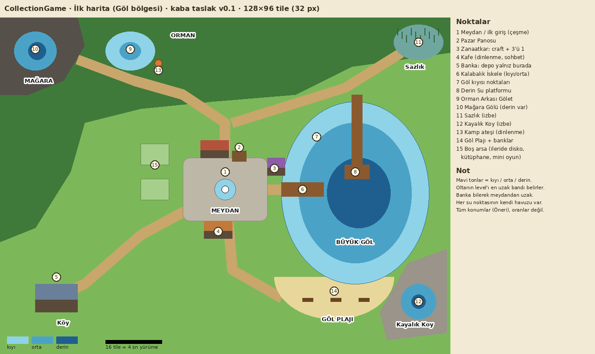

# İlk Harita: Göl Bölgesi

Durum: **kaba taslak v0.1** (18.10.2026). Konumlar ve boyutlar **(Öneri)**; Onur'la netleştikçe güncellenir.

Görsel: `docs/gorsel/harita-taslak-v0.1.png` (şematik, pixel-art değil). Genel kurallar: `02-harita-sunucu.md`, görsel stil: `15-gorsel-stil.md`.

## Boyut ve ölçek

- **(Öneri)** 128 × 96 tile (32 px tile ile 4096 × 3072 px). 200 oyuncu için kalabalık yerlerde sıkışmadan, izbe köşelerde yalnız kalacak kadar yer.
- **(Öneri)** Yürüme hızı ~4 tile/sn: meydandan en uzak köşeye ~15–20 saniye. Yürüme hızı sunucu config'idir.
- Tek açık harita, oda yok (bkz. 4.0). Mağara da ayrı sahne değil, haritanın karanlık bir köşesidir.

## Yerleşim mantığı

Merkezde kalabalık, kenarlara doğru sakinlik ve nadirlik artar.

| # | Yer | Konum | Ne işe yarar |
|---|---|---|---|
| 1 | **Meydan** | Ortada | İlk giriş noktası (çeşme). Yolların kesiştiği, herkesin geçtiği yer |
| 2 | Pazar Panosu | Meydanın kuzeyi | Pazar yalnızca buradan açılır (bkz. 12.3) |
| 3 | Zanaatkar NPC | Meydanın doğusu, göl yolunda | Craft ve 3'ü 1 birleştirme (bkz. 9.4, 11) |
| 4 | Kafe | Meydanın güneyi | Dinlenme alanı ve sohbet mekanı |
| 5 | **Banka** | Güneybatı köyü, meydandan uzak | **Depo yalnızca burada açılır** (bkz. 9.3). Uzaklık bilinçli: çanta yönetimi bir karar olsun |
| 6 | Kalabalık İskele | Meydanın hemen doğusu, Büyük Göl'e uzanır | Yeni oyuncunun ilk balık yeri. Kıyı + orta |
| 7 | Göl kıyısı noktaları | Büyük Göl'ün çevresi | Daha sakin, aynı göl. Kıyı + orta |
| 8 | Derin Su platformu | Büyük Göl'ün ortası, kuzey kıyıdan uzun iskeleyle | Derin bandın merkezde olduğu tek yer. İyi olta ile anlamlı |
| 9 | Orman Arkası Gölet | Kuzey, ormanın içinde | Küçük, sakin. Kıyı + orta |
| 10 | Mağara Gölü | Kuzeybatı köşe, karanlık | En uzak nokta. Kıyı + orta + derin. En nadir eşyalar (kristaller) |
| 11 | Sazlık | Kuzeydoğu köşe | İzbe köşe, kalabalığı duymayan yer. Kıyı |
| 12 | Kayalık Koy | Güneydoğu köşe | İzbe köşe, küçük ama derin. Kıyı + orta + derin |
| 13 | Kamp ateşi | Orman, gölete yakın | Dinlenme alanı |
| 14 | Göl Plajı + banklar | Büyük Göl'ün güney kıyısı | Dinlenme alanı ve sohbet mekanı (plaj) |
| 15 | Boş arsalar | Meydanın batısı | İleride disko, kütüphane, mini oyunlar (bkz. açık soru 1) |

## Dinlenme alanları

Kafe, Göl Plajı'ndaki banklar ve kamp ateşi. Oturunca enerji daha hızlı dolar (**Öneri:** 3 kat, bkz. 03). Her biri farklı kalabalık seviyesinde: kafe meydanın dibinde, plaj orta, kamp ateşi sakin.

## Balık noktaları ve havuzlar

- Her su noktasının **kendi eşya havuzu** vardır; havuzda olmayan eşya orada çıkmaz (bkz. 03).
- Faz 1'de tek bölge (Göl) vardır: noktaların havuzları Göl bölgesi havuzunun **alt kümeleridir** ve kısmen örtüşür.
- Her nokta kıyı / orta / derin bantlarından hangilerinin bulunduğunu belirtir (tabloda). Küçük sular derin bant içermez.
- Havuz içerikleri ve oranlar sunucu verisidir, haritada tutulmaz. Client yalnızca "hangi noktadayım, hangi bant" niyetini gönderir; sunucu oyuncunun konumunu doğrular.

### Setlerin dağılımı (Öneri)

| Defter sayfası | Ağırlıklı çıktığı yer |
|---|---|
| Göl Balıkları | Tüm noktalar (yaygınlar her yerde, nadirler kenarlarda) |
| Derin Su | Derin Su platformu, Kayalık Koy ve Mağara Gölü'nün derin bandı |
| Hazineler | İzbe köşeler (Sazlık, Kayalık Koy) ve Mağara Gölü |
| Çöp Seti | Kalabalık İskele ve kıyı bantları |

Yeni setler haritaya dağılır: bir set tek noktaya bağlanmaz, ama her setin "en iyi yeri" olur. "Mavi kristal nerede çıkıyor?" sohbeti bundan doğar.

## Yollar

Meydandan dört yol çıkar: kuzeye orman ve mağaraya, doğuya iskele ve göle (kuzey kıyıdan sazlığa devam eder), güneye kafe ve plaja, güneybatıya köy ve bankaya. İzbe köşelere yol yarım gider, son kısmı patikadır.

## Faz sırası (Öneri)

Harita bir kerede yapılmaz, sistemler geldikçe büyür:

| Faz | Haritaya eklenen |
|---|---|
| 1 | Meydan, çeşme, Büyük Göl'ün batı yarısı, Kalabalık İskele, kafe (yürüme ve chat testi için yeter) |
| 2 | Göl kıyısı noktaları, Derin Su platformu, Orman Arkası Gölet, kamp ateşi, plaj (balık tutma ve dinlenme) |
| 4 | Zanaatkar, Banka ve köy, Mağara Gölü, izbe köşeler |
| 5 | Pazar Panosu |

Pano ve zanaatkarın yeri baştan ayrılır, sistemleri gelene kadar boş durur.
