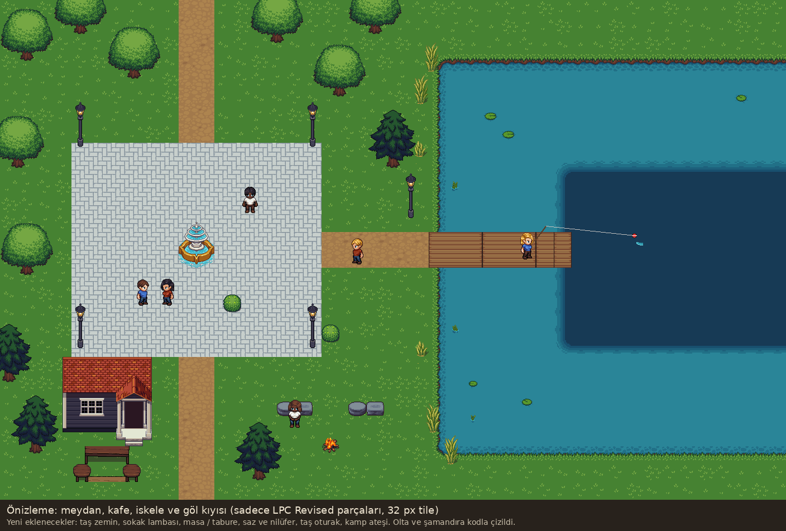

# İlk Harita: Göl Bölgesi

Durum: **kaba taslak v0.1** (18.10.2026). Konumlar ve boyutlar **(Öneri)**; Onur'la netleştikçe güncellenir.

Görsel: `docs/gorsel/harita-taslak-v0.1.png` (şematik, pixel-art değil). Genel kurallar: `02-harita-sunucu.md`, görsel stil: `15-gorsel-stil.md`.

## Boyut ve ölçek

- **(Öneri)** 128 × 96 tile (32 px tile ile 4096 × 3072 px). 200 oyuncu için kalabalık yerlerde sıkışmadan, izbe köşelerde yalnız kalacak kadar yer.
- **(Öneri)** Yürüme hızı ~4 tile/sn: meydandan en uzak köşeye ~15–20 saniye. Yürüme hızı sunucu config'idir.
- Tek açık harita, oda yok (bkz. 4.0). Mağara da ayrı sahne değil, haritanın karanlık bir köşesidir.

## Yerleşim mantığı

Merkezde kalabalık, kenarlara doğru sakinlik ve nadirlik artar.

| # | Yer | Konum | Ne işe yarar |
|---|---|---|---|
| 1 | **Meydan** | Ortada | İlk giriş noktası (çeşme). Yolların kesiştiği, herkesin geçtiği yer |
| 2 | Pazar alanı + Pazar Panosu | Meydanın kuzeyi | Oyuncuların petleri burada tezgah açar, pano tezgah reklamlarını gösterir (bkz. 12.3, Öneri: ~40 tezgah yeri) |
| 3 | Zanaatkar NPC | Meydanın doğusu, göl yolunda | Craft ve 3'ü 1 birleştirme (bkz. 9.4, 11) |
| 4 | Kafe | Meydanın güneyi | Dinlenme alanı ve sohbet mekanı |
| 5 | **Banka** | Güneybatı köyü, meydandan uzak | **Depo yalnızca burada açılır** (bkz. 9.3). Uzaklık bilinçli: çanta yönetimi bir karar olsun |
| 6 | Kalabalık İskele | Meydanın hemen doğusu, Büyük Göl'e uzanır | Yeni oyuncunun ilk balık yeri. Kıyı + orta |
| 7 | Göl kıyısı noktaları | Büyük Göl'ün çevresi | Daha sakin, aynı göl. Kıyı + orta |
| 8 | Derin Su platformu | Büyük Göl'ün ortası, kuzey kıyıdan uzun iskeleyle | Derin bandın merkezde olduğu tek yer. İyi olta ile anlamlı |
| 9 | Orman Arkası Gölet | Kuzey, ormanın içinde | Küçük, sakin. Kıyı + orta |
| 10 | Mağara Gölü | Kuzeybatı köşe, karanlık | En uzak nokta. Kıyı + orta + derin. En nadir eşyalar (kristaller) |
| 11 | Sazlık | Kuzeydoğu köşe | İzbe köşe, kalabalığı duymayan yer. Kıyı |
| 12 | Kayalık Koy | Güneydoğu köşe | İzbe köşe, küçük ama derin. Kıyı + orta + derin |
| 13 | Kamp ateşi | Orman, gölete yakın | Dinlenme alanı |
| 14 | Göl Plajı + banklar | Büyük Göl'ün güney kıyısı | Dinlenme alanı ve sohbet mekanı (plaj) |
| 15 | Boş arsalar | Meydanın batısı | İleride disko, kütüphane, mini oyunlar (bkz. açık soru 1) |

## Dinlenme alanları

Kafe, Göl Plajı'ndaki banklar ve kamp ateşi. Oturunca enerji daha hızlı dolar (**Öneri:** 3 kat, bkz. 03). Her biri farklı kalabalık seviyesinde: kafe meydanın dibinde, plaj orta, kamp ateşi sakin.

## Balık noktaları ve havuzlar

- Her su noktasının **kendi eşya havuzu** vardır; havuzda olmayan eşya orada çıkmaz (bkz. 03).
- Faz 1'de tek bölge (Göl) vardır: noktaların havuzları Göl bölgesi havuzunun **alt kümeleridir** ve kısmen örtüşür.
- Her nokta kıyı / orta / derin bantlarından hangilerinin bulunduğunu belirtir (tabloda). Küçük sular derin bant içermez.
- Havuz içerikleri ve oranlar sunucu verisidir, haritada tutulmaz. Client yalnızca "hangi noktadayım, hangi bant" niyetini gönderir; sunucu oyuncunun konumunu doğrular.

### Setlerin dağılımı (Öneri)

| Defter sayfası | Ağırlıklı çıktığı yer |
|---|---|
| Göl Balıkları | Tüm noktalar (yaygınlar her yerde, nadirler kenarlarda) |
| Derin Su | Derin Su platformu, Kayalık Koy ve Mağara Gölü'nün derin bandı |
| Hazineler | İzbe köşeler (Sazlık, Kayalık Koy) ve Mağara Gölü |
| Çöp Seti | Kalabalık İskele ve kıyı bantları |

Yeni setler haritaya dağılır: bir set tek noktaya bağlanmaz, ama her setin "en iyi yeri" olur. "Mavi kristal nerede çıkıyor?" sohbeti bundan doğar.

## Yollar

Meydandan dört yol çıkar: kuzeye orman ve mağaraya, doğuya iskele ve göle (kuzey kıyıdan sazlığa devam eder), güneye kafe ve plaja, güneybatıya köy ve bankaya. İzbe köşelere yol yarım gider, son kısmı patikadır.

## Faz sırası

Karar (18.10.2026): Faz 1'de yalnızca **çekirdek** yapılır, harita sistemler geldikçe büyür. Sonraki fazların satırları (Öneri):

| Faz | Haritaya eklenen |
|---|---|
| 1 | Meydan, çeşme, Büyük Göl'ün batı yarısı, Kalabalık İskele, kafe (yürüme ve chat testi için yeter) |
| 2 | Göl kıyısı noktaları, Derin Su platformu, Orman Arkası Gölet, kamp ateşi, plaj (balık tutma ve dinlenme) |
| 4 | Zanaatkar, Banka ve köy, Mağara Gölü, izbe köşeler |
| 5 | Pazar Panosu |

Pano ve zanaatkarın yeri baştan ayrılır, sistemleri gelene kadar boş durur.

Çarpışma, su ve önemli noktalar tek dosyadadır: `content/maps/lake.json` (biçim: `docs/protokol.md`, Harita dosyası). Sunucu derlemede bu dosyayı gömer ve açılırken kontrol eder. Şimdilik taslaktan üretildi (çeşme, Büyük Göl'ün batı yarısı, iskele açık, Banka noktası). Sıradaki adım (client, Mac): harita Unity'de tilemap olarak çizilir ve bir editor komutu bu dosyayı yazar; client'taki `LakeMap.cs` kopyası da bu dosyayı okumaya geçer. İki taraf aynı çarpışmayı görmezse oyuncu düzeltme yer.

## Faz 1 için görseller

LPC Revised paketinden `client/Assets/Art/LPC/` altına eklendi (lisans: `content/CREDITS.md`):

| İhtiyaç | Dosya |
|---|---|
| Çim, toprak yol, kum, su kıyısı, kıyı/orta/derin su | `Terrain/terrain_summer.png` |
| Ağaçlar, çalılar, çiçekler, kayalar | `Terrain/trees_summer.png`, `plants_summer.png`, `flowers.png`, `wildflowers_summer.png`, `Rocks, Grasslands.png` |
| İskele | `Structure/Bridges/Wood Bridge A*.png` |
| Çeşme | `Structure/Misc/Fountain A.png` |
| Kafe (ve ileride banka) | `Structure/Structures/Paneled House A.png`, `Brick House A.png` |
| Çit, tabela | `Structure/Fences/Plain Fence A.png`, `Structure/Signs/Sign Backgrounds A.png` |
| Sonraki fazlar için hazır | `Terrain/cliff_summer.png` (mağara, kayalık), `FX/WaterRipple.png`, `FX/Splash.png` |

## Görünüm önizlemesi

Sadece LPC Revised parçalarıyla hazırlanmış bir önizleme (21.10.2026): meydan, kafe, iskele, göl kıyısı ve derin su. Konumlar haritanın kendisi değil, sadece görünümü göstermek için sıkıştırıldı.

## LPC Revised paketinde olup henüz repoya eklenmeyenler

Paket (commit `f07f7f5`) tarandı (21.10.2026). Haritanın eksik sanılan parçalarının çoğu pakette var; gerektiği fazda `client/Assets/Art/LPC/` altına aynı klasör yapısıyla kopyalanır ve sanatçısı `content/CREDITS.md`'ye yazılır.

| İhtiyaç | Faz | Pakette |
|---|---|---|
| Meydan taş döşemesi | 1 | `Structure/Floor/Herringbone A.png`, `Tile A.png` (gri taş) |
| Sokak lambası | 1 | `Objects/Furniture/Lighting, Outdoors.png` |
| Kafe dış masa / sandalye, tabela ikonu | 1 | `Objects/Furniture/Table, Rough Wood.png`, `Seating/Chair, Dining *.png`, `Seating/Bar Stools.png`, `Structure/Signs/Sign Icons A.png` |
| Kamp ateşi (4 kare animasyon) | 2 | `Objects/Small Items/Fire, Camp.png` |
| Saz, nilüfer (Sazlık, göl kenarı) | 2 | `Terrain/plants_summer.png` (repoda, kullanılmıyor) |
| Su yansıması | 2 | `FX/Water Reflections.png` |
| Zanaatkar tezgahı | 4 | `Objects/Furniture/Workbench, Carpentry.png`, `Table, Workshop.png` |
| Banka binası, kasa | 4 | `Structure/Structures/Brick House B.png`, `Objects/Furniture/Chest.png` |
| Mağara: kayalık, mantar, şelale | 4 | `Terrain/Rocks, Cliffs.png`, `mushrooms.png`, `Waterfall.png` |
| NPC'ler | 4 | LPC karakter katmanları, yaşlı kafa `Head/Head 03 - Elderly` |
| Pazar dekoru | 5 | `Objects/Furniture/Barrel.png`, `Crate.png`, `Objects/Small Items/Baskets A.png`, `Buckets.png` |
| Etkinlik dekoru | sonra | `Objects/Furniture/Christmas Tree.png`, `Objects/Small Items/Presents.png` |
| Mevsimler | sonra | `Terrain/*_spring / _autumn / _winter.png` |

Pakette olmayanlar:

- **Plaj bankı:** geçici olarak `Objects/Furniture/Stone Slab.png` (taş oturak); kalıcısı çizdirilir (**Öneri**).
- **Pazar Panosu:** `Sign Backgrounds A` + ahşap çerçeveyle denenir, olmazsa çizdirilir.

