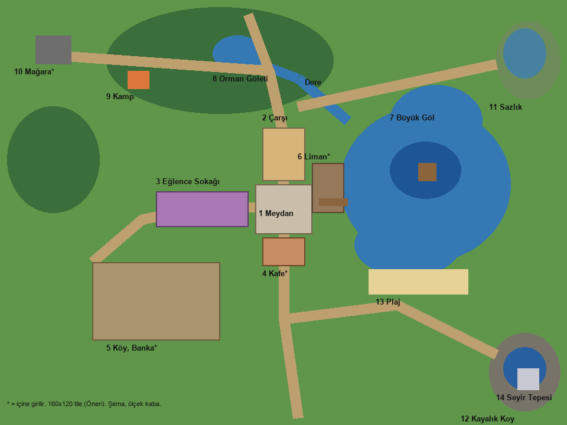

# Harita v1: Kasaba, Göl ve Mekanlar

Durum: **taslak v1.0** (28.11.2026). Yön kararları Onur'un: harita büyük olacak; binalara girilebilecek ve her mekanın ortamı farklı olacak (kafe, banka, disko tarzı); şimdilik etkinlik sistemi yok, sadece harita tasarımı. Konumlar, boyutlar ve kapasiteler **(Öneri)**.

`16-ilk-harita.md` (v0.1) yerleşim olarak bunun yerini aldı. Oradaki balık noktası ve havuz kuralları, set dağılımı ve asset tabloları geçerlidir.

## Hedef: takılmalık bir yer

Hedef Club Penguin ve Sanalika gibi, oyuncuların balık tutmasa da vakit geçirdiği bir yer. Bunu sağlayan şey alan büyüklüğü değil, **gidilecek yerlerin sayısı ve her yerin kendi havası**:

1. **Yoğun merkez, geniş çevre.** Kasaba (meydan, çarşı, kafe, liman, eğlence sokağı) sıkı durur, yürürken hep birileri görünür. Göller, orman ve izbe köşeler çevrede, sakin ve geniş.
2. **Her bölgenin bir kimliği olur.** Zemin, ışık, süs ve müzik bölgeden bölgeye değişir. Oyuncu "Disko'da buluşalım" ya da "Sazlık'tayım" diyebilmeli.
3. **Mekanlara girilir.** Kapıdan girince başka bir ortam açılır: ışık, zemin, müzik ve kalabalık değişir. Mekan içindekiler sadece birbirini görür ve duyar.
4. **Oturulacak, durulacak yer.** Her bölgede oturma noktası, bank veya kütük olur (koltuk sistemi sunucuda hazır: `SIT`).
5. **Manzara.** Çeşme, değirmen, iskele ucu ve seyir tepesi gibi yerler kozmetik göstermeye ve ekran görüntüsü almaya uygun çizilir.

## Boyut

- **(Öneri)** 160 × 120 tile (32 px ile 5120 × 3840 px). Kasaba çekirdeği ortada yaklaşık 50 × 40 tile.
- Yürüme hızı ~4 tile/sn ile meydandan en uzak köşeye ~25 sn. Daha büyüğü yürümeyi sıkıcı yapar; daha fazla alan gerekirse iç mekanlar ve ikinci bölge (ileride) eklenir.
- Kapasite 100 ya da 200 oyuncu olabilir; iki durumda da kasaba dolu, çevre sakin görünmeli.

## Bölgeler

| # | Bölge | Yer | Kimliği | İçinde |
|---|---|---|---|---|
| 1 | **Meydan** | Merkez | Taş döşeme, çeşme, banklar, fener direkleri. İlk giriş noktası | Çeşme, banklar, yön tabelası, değirmen manzarası |
| 2 | **Çarşı** | Meydanın kuzeyi | Pet tezgahlarının dizildiği sokak, kalabalık ve renkli tenteler | Pazar Panosu, tezgah sıraları (~40), Terzi (içine girilir) |
| 3 | **Eğlence Sokağı** | Meydanın batısı (eski boş arsalar) | Akşam havası, neon ve renkli ışık | Disko, Koleksiyon Müzesi (içine girilir), boş arsa (ileride oyun salonu) |
| 4 | **Kafe** | Meydanın güneyi | Sıcak, terasta masalar | Teras (dışarıda) ve kafe içi |
| 5 | **Köy** | Güneybatı | Sakin, kerpiç evler, kuyu, bahçeler, çitler | Banka (içine girilir), evler (girilmez), elma ağaçları |
| 6 | **Liman** | Meydanın doğusu, göl kıyısı | Ahşap, ağlar, sandıklar | Kalabalık İskele, Balıkçı Dükkanı ve Atölye (içine girilir) |
| 7 | **Büyük Göl** | Doğu | Doğal kıyı, nilüfer, kayık | Kıyı, orta ve derin bant; ortada Derin Su platformu (kuzey kıyıdan uzun iskele) |
| 8 | **Orman ve Orman Göleti** | Kuzey | Sık ağaç, gölge, mantar | Küçük gölet; gölden **dere** akar ve Büyük Göl'e dökülür, üzerinde iki küçük köprü |
| 9 | **Kamp Ateşi** | Ormanın batısı | Akşam ışığı, kütük oturaklar | Oturma noktaları, sakin sohbet köşesi |
| 10 | **Mağara** | Kuzeybatı köşe | Kayalık giriş | İçine girilir: Mağara Gölü içeride |
| 11 | **Sazlık** | Kuzeydoğu köşe | Uzun sazlar, sis, kimse yok | Küçük su, sadece kıyı bandı |
| 12 | **Kayalık Koy** | Güneydoğu köşe | Kayalar, dalga | Küçük ama derin su |
| 13 | **Plaj** | Büyük Göl'ün güney kıyısı | Kum, şemsiye, şezlong | Oturma noktaları, kumdan kale |
| 14 | **Seyir Tepesi** | Kayalık Koy'un üstü | Haritanın en yüksek yeri, göl manzarası | Bank, dürbün; manzara ve buluşma yeri |

**Yollar:** Kasabada taş döşeme, çevrede toprak yol ve izbe köşelere giden patika. Yollar düz değil, kıvrımlı. Meydandan dört ana yol çıkar: kuzeye çarşı ve orman, batıya eğlence sokağı ve köy, güneye kafe ve plaj, doğuya liman. Göl kıyısında halka bir yol, sazlık ve kayalık koya patika iner.

**Balık noktaları:** Büyük Göl (kıyı ve orta bant; derin bant platform çevresinde), Kalabalık İskele, Orman Göleti, dere (sadece kıyı bandı), Sazlık, Kayalık Koy ve Mağara Gölü (iç mekan). Su noktaları ve bantları `16-ilk-harita.md`'deki kurallarla çalışır; her su ayrı bir `waters` kaydıdır.

## Mekanlar (iç mekan)

| Mekan | Nerede | Ortam | Ne yapılır | Kapasite (Öneri) |
|---|---|---|---|---|
| **Kafe** | Meydanın güneyi | Sıcak sarı ışık, ahşap zemin, fincan sesleri, sakin müzik | Oturunca enerji bonusu, sohbet | 40 |
| **Banka** | Köy | Mermer zemin, sessiz, gişe arkasında NPC, kasa | Depo (yalnızca burada) | 30 |
| **Disko** | Eğlence Sokağı | Karanlık, renkli ışıklar, yanıp sönen dans pisti, DJ kabini, güçlü müzik | Dans pistinde emote, sohbet | 60 |
| **Koleksiyon Müzesi** | Eğlence Sokağı | Sessiz, vitrinler, spot ışıkları | Setlerin ve nadir eşyaların sergisi (Öneri: sunucudaki en yüksek Collection Score'luların vitrinleri) | 40 |
| **Terzi** | Çarşı | Aynalar, kumaş topları, prova kabini | Gardırop ve prova odası (`20-gardirop.md`) | 25 |
| **Balıkçı Dükkanı** | Liman | Ağlar, oltalar, balık tezgahı | NPC satış, yem, olta tamiri | 25 |
| **Atölye** | Liman | Tezgahlar, alet duvarı, kıvılcımlar | Craft, birleştirme (Zanaatkar) | 25 |
| **Mağara** | Kuzeybatı | Karanlık, kristallerin mavi ışığı, damla sesleri | Mağara Gölü'nde balık tutma, en nadir eşyalar | 30 |

- Bugün dışarıdaki NPC'lerle açılan pencereler (satış, craft, depo) mekanın içine taşınır. Mekan dışından bu işler yapılamaz.
- Evler ve değirmen girilmez, dış süs olarak kalır. Oyuncu evleri (açık soru 33) ayrı bir tasarım konusudur.
- İç mekanlarda balık tutulmaz, Mağara hariç.
- Mekan doluysa kapı "Dolu" der, oyuncu dışarıda kalır (Öneri). Kapasite sunucu config'idir.

## İç mekanlar nasıl çalışır (Öneri, teknik)

- **Aynı match, ayrı bölge.** Her sunucu yine tek bir match'tir. İç mekanlar aynı harita dosyasında, dış haritanın dışında ayrı alanlar olarak durur (ör. x ≥ 200 şeridi). Böylece çarpışma, hız sınırı ve yakınlık sistemi olduğu gibi çalışır. Mekandakiler dışarıdakileri görmez, çünkü uzaktırlar.
- **Kapı.** Harita dosyasında her kapının dışarıdaki noktası ve içerideki karşılığı tanımlıdır. Oyuncu kapıya yürüyüp girme niyeti gönderir; sunucu kapıya uzaklığını (≤ 1.5 tile, Öneri) ve kapasiteyi kontrol eder, oyuncuyu içeriye taşır ve yakınındakilere bildirir. Çıkış da aynı şekilde çalışır.
- **Sohbet.** İç mekanda yakınlık yarıçapı mekanın tamamını kaplar (küçük mekanlarda herkes herkesi duyar).
- **Ortam.** Işık rengi, müzik ve zemin client tarafındadır, mekan kimliğinden seçilir. Sunucu sadece oyuncunun hangi mekanda olduğunu bilir.
- **Arkadaşın yanına ışınlanma:** Arkadaş bir mekandaysa ışınlanma mekanın kapısının önüne indirir, içeri girmek oyuncunun kararıdır (Öneri).
- Bunlar için yeni mesajlar gerekir. **Sözleşme önce:** önce `docs/protokol/dunya.md` ve `docs/protokol.md` op code dizini yazılır, sonra sunucu ve client.

## Sıra

1. Dış harita v1: yerleşim, su noktaları, yollar ve çarpışma (harita dosyası betikle üretilir; sunucu ve client aynı veriyi okur).
2. Kapı ve iç mekan sistemi: protokol, sunucu, client.
3. İlk mekanlar: Kafe, Banka, Balıkçı Dükkanı (bugünkü işlevlerin taşındığı yerler).
4. Sonraki mekanlar: Disko, Atölye, Terzi, Mağara, Koleksiyon Müzesi.

## Gereken görseller

Hepsi `docs/araclar/harita-asset-promptu.md` ile üretilir.

- **Dış:** doğal göl kıyısı ve dere parçaları, köprü, taş döşeme ve patika, çiçek ve ot kümeleri, tente ve tezgah sırası, seyir tepesi bankı ve dürbün; yeni cepheler: Disko, Müze, Terzi, Mağara girişi (var), Balıkçı Dükkanı (var), Atölye (var), Banka (var), Kafe (var).
- **İç:** her mekan için zemin ve duvar parçaları ile 6-12 mobilya. İç mekan açısı dışarıyla aynıdır: düz önden, üst yüzeyler hafif üstten, arka duvar görünür, yan duvar görünmez.

## Açık noktalar

- Koleksiyon Müzesi'nde vitrinler nasıl seçilir (en yüksek skor, en nadir eşya, sırayla oyuncu vitrinleri)?
- Disko'da dans pisti emote dışında bir şey yapsın mı (otomatik dans)? Etkinlik sistemi şimdilik yok.
- Eğlence Sokağı'ndaki boş arsa ne olacak (oyun salonu, mini oyunlar)?
